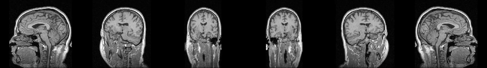

# Plane Projection of a 3D Volume

Introduction to Software Engineering: Ex1.

Given a 3D raster volume `M` (for example an MRI scan in NRRD format) and a plane
described by 3 or 4 points, compute the 2D image of the volume along that plane.
A sequence of planes becomes a video.



## Problem

* **Input:** a volume `M[x][y][z]` of size `sx × sy × sz` (`1 ≤ s < 2^10`) with 8/16/32-bit integer
  voxels, plus a plane given as
  * an **isosceles triangle** `(a, b, c)` with `|dist(a,b) − dist(a,c)| < 0.001`, or
  * an **isosceles trapezoid** `(a1, a2, b, c)` with equal legs `a1→b`, `a2→c`,
    `dist(a1,a2) ≤ dist(b,c)`, and all four points on one plane.
* **Output:** a 2D matrix `E` of size `⌊Dab⌋ × (⌊Dbc⌋+1)` where each pixel holds the voxel
  of `M` at the matching point of the plane (0 outside `M`).
* **Performance:** at least 30 frames per second on a 500³ volume; 100 FPS is the target.

The assignment's algorithm is intentionally under-specified. Every decision taken to make it
implementable (rounding, first row, output size, out-of-volume values, and so on) is listed
in [docs/SRS.md](docs/SRS.md) and explained in [docs/ALGORITHM.md](docs/ALGORITHM.md).

## Scope

In scope: loading NRRD volumes, validating planes, projecting with nearest-neighbour
sampling, reading plane lists from CSV, and writing an mp4 with one frame per plane.

Out of scope: physical (mm) coordinates (planes are given in **voxel indices**),
interpolation between voxels, a GUI, and 3D rendering.

## Quick start

```bash
python -m venv .venv
.venv\Scripts\activate            # Windows  (Linux/macOS: source .venv/bin/activate)
pip install -r requirements.txt

python Ex0.py data/MRHead_1.nrrd data/planes_rotate.csv rotate.mp4
```

Output:

```
Volume: (256, 256, 130) int16
Planes: 90
Projected 90 frames in 0.238s (378.4 fps)
Saved: rotate.mp4
```

`--fps N` sets the video frame rate (default 10). Invalid input prints `Error: ...` (with the
CSV line number) and exits with code 1.

### CSV format

One plane per row, comma separated, with an optional header row:

```
ax,ay,az,bx,by,bz,cx,cy,cz                      # triangle: 9 numbers
a1x,a1y,a1z,a2x,a2y,a2z,bx,by,bz,cx,cy,cz       # trapezoid: 12 numbers
```

## Project structure

```
Ex0.py                     demo CLI: python Ex0.py file.nrrd file.csv file.mp4
projection/
  plane.py                 Plane: immutable, always-valid triangle/trapezoid
  volume.py                Volume: validated 3D array + NRRD header
  projector.py             Projector interface, ReferenceProjector, FastProjector
  plane_reader.py          read_planes(csv) -> list[Plane]
  video.py                 VideoWriter: normalize, pad, encode mp4
tests/                     41 unit, oracle, performance and end-to-end tests
experiments/               plane generators, benchmark, preview images
data/                      MRHead_1.nrrd and the plane CSV files
results/                   experiment videos, previews and benchmark table
docs/                      SRS, algorithm, design, testing, dataset, experiment
```

## Design overview

```
                +-------------------+
 Ex0.py  ---->  |  read_planes(csv) | ---> [Plane, Plane, ...]
   |            +-------------------+
   |   Volume.from_nrrd(path)                     Projector  (interface)
   |        |                                       ^         ^
   |        v                                       |         |
   +--> FastProjector.project(volume, plane) ReferenceProjector FastProjector
             |                                 (oracle, loops) (vectorized)
             v
        [E, E, ...] ---> VideoWriter.write(frames, mp4)
```

* **Strategy pattern:** both projectors implement the same `Projector` interface. The
  readable loop version is the specification in code and serves as the test oracle. The
  vectorized version is the one used in production.
* **Plane as a value object:** validation happens in the constructor and points are read-only,
  so an invalid plane cannot exist anywhere in the program.
* Each class has one responsibility. I/O (NRRD, CSV, mp4) is kept at the edges, so the core
  can be tested without files.
* **`Volume` owns the memory layout:** pynrrd returns Fortran-ordered arrays. `Volume`
  converts them once to C order, so `FastProjector` can use `M.ravel()` as a free view
  instead of copying the volume on every frame.
* **Errors are messages, not crashes:** library code raises `ValueError` with a precise
  message, `read_planes` adds the CSV line number, and `Ex0.main` prints `Error: ...` and
  returns exit code 1. `main(argv)` returns the code instead of calling `sys.exit`, so the
  tests can call it directly.

| Module | Class / function | Responsibility |
|---|---|---|
| `plane.py` | `Plane` | Holds and validates the triangle/trapezoid; exposes its geometry |
| `volume.py` | `Volume` | Read-only, C-contiguous 3D array plus NRRD header; `from_nrrd(path)` |
| `projector.py` | `Projector` | Interface: `project(volume, plane) -> E` |
| | `ReferenceProjector` | Loop translation of the algorithm (specification and test oracle) |
| | `FastProjector` | Vectorized NumPy implementation (production) |
| `plane_reader.py` | `read_planes(csv)` | CSV rows to `Plane` objects, with line-numbered errors |
| `video.py` | `VideoWriter` | Intensity normalization, padding, mp4 encoding |
| `Ex0.py` | `main(argv)` | CLI: wires the components, reports timing and errors |

`projection.project_plane(M, a, b, c, a_second=None)` keeps the original function signature,
so the first tests written for the single-file version still run unchanged.

## Results

| | |
|---|---|
| FPS on a 500³ volume (oblique plane, 559×501 output) | **83–103** (requirement ≥ 30) |
| FPS on MRHead (256×256 output) | **300–520** |
| Speed-up over the Python-loop implementation | **17–40×** on 500³, **~100×** on 128³ |
| Fast vs. reference implementation | identical on 100 random planes |

Videos: [results/rotate.mp4](results/rotate.mp4), [results/triangle.mp4](results/triangle.mp4),
[results/sweep.mp4](results/sweep.mp4), [results/sagittal5.mp4](results/sagittal5.mp4).
The full report is in [docs/EXPERIMENT.md](docs/EXPERIMENT.md).

## Tests

```bash
python -m unittest -v
```

The testing strategy is described in [docs/TESTING.md](docs/TESTING.md).

## Documents

| Document | Content |
|---|---|
| [docs/SRS.md](docs/SRS.md) | Software Requirements Specification |
| [docs/ALGORITHM.md](docs/ALGORITHM.md) | The projection algorithm in detail, with design decisions |
| [docs/TESTING.md](docs/TESTING.md) | Testing strategy, including the demo |
| [docs/DATASET.md](docs/DATASET.md) | The NRRD data set |
| [docs/EXPERIMENT.md](docs/EXPERIMENT.md) | Experiment and results |
