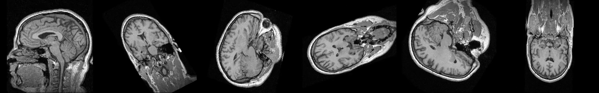

# Plane Projection of a 3D Volume

Introduction to Software Engineering: Ex1.



## Problem

Given a 3D volume `M` (an NRRD file, for example an MRI scan) and a plane, compute the 2D
image of the volume along that plane. The plane is an isosceles triangle `(a, b, c)` or an
isosceles trapezoid `(a1, a2, b, c)`. A list of planes becomes a video, one frame per plane.

Requirement: at least 30 frames per second on a 500×500×500 volume.

## Scope

* In scope: reading NRRD volumes, validating planes, projecting (nearest voxel, 0 outside
  the volume), reading planes from CSV, writing an mp4.
* Out of scope: physical (mm) coordinates (planes are given in voxel indices), interpolation
  between voxels, and a GUI.

## How to run

```bash
pip install -r requirements.txt
python Ex0.py data/MRHead_1.nrrd data/planes_tumble.csv tumble.mp4
python Ex0.py data/MRHead_1.nrrd data/lecturer_example.csv lecturer.mp4 --fps 1
python -m unittest -v
```

CSV format: the lecturer's example file ([data/lecturer_example.csv](data/lecturer_example.csv)).
One plane per row: `3,a,b,c` (with empty columns at the end) for a triangle, or
`4,a1,b,a2,c` for a trapezoid. An invalid row is reported and gets a black frame.

## Project structure

```
Ex0.py          demo: python Ex0.py file.nrrd file.csv file.mp4
projection/     the code: Plane, Volume, Projector, read_planes, VideoWriter
tests/          unit, performance and end-to-end tests
data/           MRHead_1.nrrd and plane CSV files
experiments/    scripts that produced the results
results/        output video and benchmark
docs/           SRS, algorithm, testing, dataset, experiment
```

## Results

| | FPS |
|---|---:|
| 500³ volume (requirement ≥ 30, expected 100) | 163–192 |
| MRHead (256×256×130) | 300–550 |

The video is [results/tumble.mp4](results/tumble.mp4). Details are in [docs/EXPERIMENT.md](docs/EXPERIMENT.md).

## Documents

* [SRS](docs/SRS.md)
* [Algorithm](docs/ALGORITHM.md)
* [Testing strategy](docs/TESTING.md)
* [Dataset](docs/DATASET.md)
* [Experiment](docs/EXPERIMENT.md)

## Use of AI tools

This project was developed with the help of Claude (Anthropic), as permitted in the course.
I wrote the first working implementation of the algorithm; the AI helped with performance
optimization, the object-oriented structure, tests and documentation. I reviewed and
understand all of the code.
