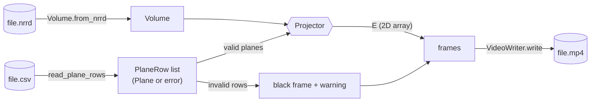
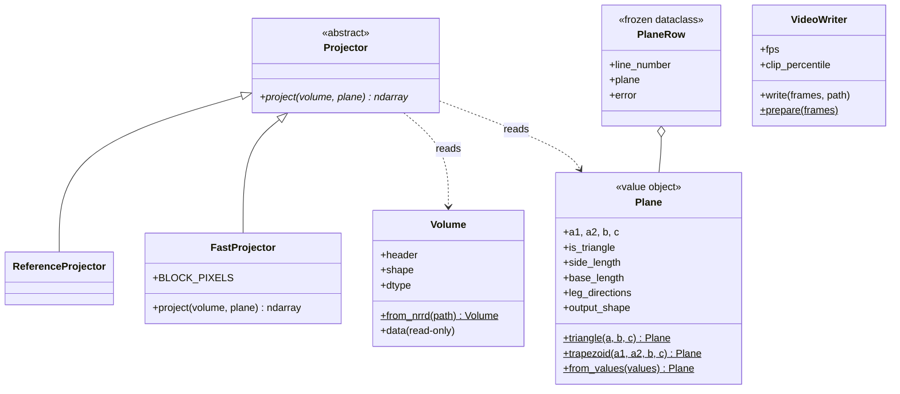

# Design

How the program is built, and why. Requirement numbers (FR-x, NFR-x, D-x) refer to the
[SRS](SRS.md); the projection math itself is in [ALGORITHM.md](ALGORITHM.md).

## 1. The big picture: a pure core with I/O at the edges



Files are touched in exactly three places: `Volume.from_nrrd`, `read_plane_rows` and
`VideoWriter.write`. Everything between them (`Plane`, `Projector`, `VideoWriter.prepare`)
works on objects and NumPy arrays only. This is why almost all tests run without any file:
they build a `Volume` from an array and a `Plane` from numbers (NFR-5).

`Ex0.py` is the only place that knows about the command line, prints messages and turns
errors into exit codes. The `projection` package never prints and never exits.

## 2. Classes



### Responsibilities (CRC cards)

**Plane**: *knows* the four points of a valid triangle or trapezoid and the derived geometry
(`Dab`, `Dbc`, leg directions, image size). *Does* all validation of FR-4 – FR-7 and D10 in its
constructor. *Collaborators:* none; it depends only on NumPy.

**Volume**: *knows* the 3D voxel array (C-contiguous, read-only) and the NRRD header. *Does*
the checks of FR-2 and the one conversion from pynrrd's Fortran order. *Collaborators:* pynrrd,
only inside `from_nrrd`.

**Projector** (interface): *does* one thing, `project(volume, plane) → E`, with the shape
`plane.output_shape` and the volume's voxel type. *Collaborators:* `Volume`, `Plane`.

- **ReferenceProjector**: the algorithm of the assignment as plain loops, written to be read.
  It is the specification in code and the test oracle (NFR-2).
- **FastProjector**: the same result with NumPy, in row blocks on a small thread pool
  (ALGORITHM.md, section 4).

**read_plane_rows / PlaneRow**: *does* the CSV format (count column, `a1,b,a2,c` order,
header, comments, separators). *Knows* for every data row its line number and either a
`Plane` or the reason it is invalid. *Collaborators:* `Plane` (to validate).

**VideoWriter**: *does* everything about turning images into a video: one global gray-level
window, padding to a common size, cropping empty margins, H.264 encoding. *Collaborators:*
imageio, only inside `write`.

**Ex0.main**: *does* the run: arguments, reading, projecting, timing, writing, and the
translation of every error into `Error: ...` and exit code 1. *Collaborators:* all of the above.

## 3. Design principles, with the place in the code

| Principle | Where |
|---|---|
| **Single responsibility** | Geometry and its rules live only in `Plane`; voxels only in `Volume`; sampling only in a `Projector`; gray levels and encoding only in `VideoWriter`. A change of the video format touches one class. |
| **Open/closed** | A new sampling method (e.g. trilinear interpolation) is a new `Projector` subclass. `Ex0.py`, the tests' oracle and the video code do not change. |
| **Liskov substitution** | Every `Projector` returns the same shape and type for the same input, so the oracle test can swap `FastProjector` for `ReferenceProjector` and compare pixel by pixel. |
| **Interface segregation** | `Projector` has a single method; a projector does not have to know about files or video. |
| **Dependency inversion** | The tests and the benchmark work with any `Projector` they are given (the same test runs on both). The concrete choice of `FastProjector` is made in one line, in `Ex0.main` and in `project_plane`. |
| **Fail fast / always valid** | A `Plane` or `Volume` that exists is valid: the constructor checks and raises. Later code never re-checks. |
| **Immutability** | `Plane` uses `__slots__` and read-only point arrays; `Volume.data` is read-only; `PlaneRow` is frozen. Objects can be shared between threads safely (used by `FastProjector`). |

## 4. Patterns

| Pattern | Where | Why |
|---|---|---|
| **Strategy** | `Projector` → `ReferenceProjector`, `FastProjector` | Two ways to compute the same thing: one to trust, one to run fast |
| **Value object** | `Plane` | Defined only by its points, cannot change, valid by construction |
| **Named factory methods** | `Plane.triangle`, `Plane.trapezoid`, `Plane.from_values`, `Volume.from_nrrd` | Clear names for the different ways to create the object; the constructor stays simple |
| **Result object** | `PlaneRow` (a plane *or* an error) | A bad row does not stop the reading, and frame N still matches row N (FR-8, D11) |
| **Facade** | `project_plane(M, a, b, c)` | One call for the simple case: a raw array and points in, an image out |

## 5. Alternatives we considered and rejected

| Alternative | Why we did not use it |
|---|---|
| A class hierarchy `Plane → Triangle, Trapezoid` | The algorithm treats a triangle as a trapezoid with `a1 = a2`, and so do both projectors. Two subclasses would split one set of rules into two places with no change in behavior. The difference is kept in the factory methods and in `is_triangle`. |
| Projection as a method of `Plane` (`plane.project(volume)`) | It would tie geometry to one sampling method, and the two projectors could not be compared with each other. |
| Custom exception classes | Python's `ValueError` (bad content) and `OSError` (bad file) already separate the two kinds of problems, and `Ex0.main` treats them the same way. |
| An application class (`ProjectionApp`) | The whole run is about 40 lines in `Ex0.main`; a class would add structure without removing any complexity. |
| Validating in the reader instead of in `Plane` | Planes built in code (tests, `project_plane`) would then skip validation. In the constructor, no path can create an invalid plane. |
| A compiled extension (Numba) for speed | Faster, but an extra dependency and a second language of code. NumPy with row blocks and threads already exceeds the 100 FPS target (NFR-6). |
| float32 coordinates in `FastProjector` | About 15% faster, but on long planes it rounded about one pixel per plane differently from the reference (NFR-2). |

## 6. Errors: where they are raised and where they are handled

| Problem | Raised by | Handled by |
|---|---|---|
| Missing or unreadable file | `open`, pynrrd (`OSError`) | `Ex0.main`: `Error: ...`, exit 1 |
| Corrupt NRRD, wrong shape or voxel type | `Volume` (`ValueError`) | `Ex0.main`: `Error: ...`, exit 1 |
| Invalid plane or bad CSV row | `Plane`, `_parse_plane` (`ValueError`) | `read_plane_rows` keeps it in a `PlaneRow`; `Ex0.main` prints a warning and draws a black frame |
| No valid row at all, bad `--fps`, output not `.mp4` | `Ex0.main`, `VideoWriter` | `Ex0.main`: `Error: ...`, exit 1 |
| Out of memory | NumPy (`MemoryError`) | `Ex0.main`: `Error: ...`, exit 1 |

No error reaches the user as a traceback (NFR-3).

## 7. Package layout

```
Ex0.py                     command line, messages, exit codes
projection/
  __init__.py              public API and the project_plane facade
  plane.py                 Plane (value object, validation), EPS
  volume.py                Volume (NRRD loading, checks)
  projector.py             Projector, ReferenceProjector, FastProjector
  plane_reader.py          CSV format: read_plane_rows, PlaneRow, read_planes
  video.py                 VideoWriter, pad_to_size, crop_black_margins
tests/                     one test file per area (see TESTING.md)
experiments/               plane generators, benchmark, previews
```
