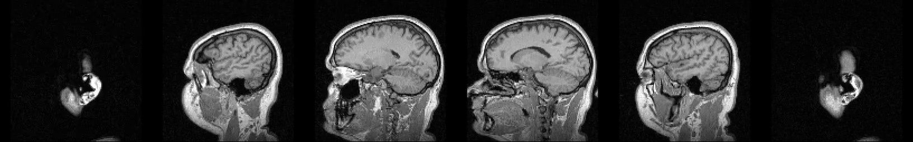
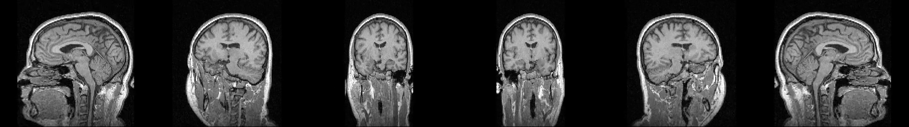
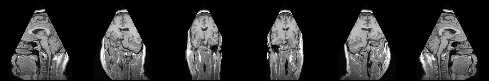
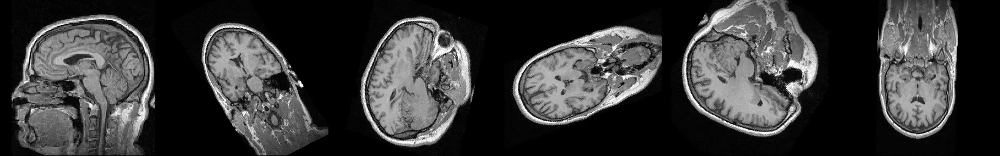
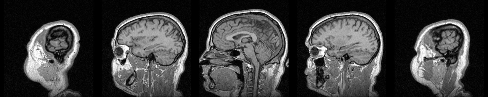

# Experiment and Results

## Goals

1. Show that the demo produces correct, readable videos for triangles and trapezoids,
   including oblique planes that are not available as standard slice views.
2. Measure performance against the requirement (≥ 30 FPS on 500³, target 100 FPS).

## Setup

* Machine: Intel Core (family 6 model 186), Windows 11, Python 3.14, NumPy 2.5.
* Volume: `data/MRHead_1.nrrd` (256×256×130, int16) for the videos; random volumes for
  the benchmark.
* Commands:

```bash
python experiments/make_planes.py
python Ex0.py data/MRHead_1.nrrd data/planes_sweep.csv    results/sweep.mp4    --fps 15
python Ex0.py data/MRHead_1.nrrd data/planes_rotate.csv   results/rotate.mp4   --fps 15
python Ex0.py data/MRHead_1.nrrd data/planes_triangle.csv results/triangle.mp4 --fps 15
python Ex0.py data/MRHead_1.nrrd data/planes_tumble.csv   results/tumble.mp4   --fps 15
python Ex0.py data/MRHead_1.nrrd data/planes_sagittal5.csv results/sagittal5.mp4 --fps 2
python experiments/make_previews.py
python experiments/benchmark.py
```

## Part 1: Videos

| Video | Planes | Projection time | FPS | Preview |
|---|---|---|---|---|
| [sweep.mp4](../results/sweep.mp4) | 130 sagittal rectangles | 0.25 s | ~480–520 |  |
| [rotate.mp4](../results/rotate.mp4) | 90 rotating rectangles | 0.24 s | ~380–390 |  |
| [triangle.mp4](../results/triangle.mp4) | 60 rotating triangles | 0.18–0.20 s | ~300–330 |  |
| [tumble.mp4](../results/tumble.mp4) | 120 squares turning freely in 3D | 0.14 s | ~880 |  |
| [sagittal5.mp4](../results/sagittal5.mp4) | 5 sagittal rectangles | 0.02–0.03 s | ~160–310 |  |

Observations:

* **Sweep:** moves from one side of the head (ear) through the mid-sagittal plane (corpus
  callosum, brainstem, cerebellum, spine) to the other side. It is symmetric, as expected.
* **Rotate:** at 0° the slice is sagittal, at 90° coronal (both hemispheres and the ventricles
  visible), at 180° sagittal again but mirrored. This confirms that oblique planes work and
  that the leg/row orientation is consistent.
* **Triangle:** the same rotation with a triangle. The image is a centered triangle, narrow at
  the top of the head and widening towards the neck, as defined by the algorithm (row `y`
  has length `d12(y)`, centered by `off(y)`).
* **Tumble:** a square through the head center whose rotation axis itself keeps changing
  (two rotations at different speeds). The frames pass through sagittal, coronal, axial and
  many oblique slices that no standard slice view shows. It is the fastest video because a
  large part of each oblique square falls outside the narrow (130-voxel) left-right axis,
  and those pixels all read index 0, which is always in the CPU cache.
* Planes extend beyond the volume (300-voxel-wide rectangles in a 256×130 cross-section).
  The outside parts are black (value 0), as required.
* Intensities: a global window [min, 99.5th percentile] keeps gray levels consistent across
  frames. Using the raw maximum made all frames dark, because a few very bright voxels
  stretched the scale.

## Part 2: Performance

From [results/benchmark.md](../results/benchmark.md) (each value is the mean over ≥ 1 s of
repeated projections, after one warm-up call):

| Implementation / plane | Volume | Output | FPS |
|---|---|---|---:|
| Fast, oblique triangle | 128³ uint8 | 143×129 | 2,422 |
| Fast, oblique triangle | 256³ uint8 | 286×257 | 375 |
| Fast, oblique triangle | **500³ uint8** | 559×501 | **83.5** |
| Fast, oblique triangle | 750³ uint8 | 838×751 | 34.6 |
| Fast, oblique triangle | 500³ uint16 | 559×501 | 103.2 |
| Fast, oblique triangle | 500³ uint32 | 559×501 | 102.3 |
| Fast, axis-aligned square | 500³ uint8 | 499×500 | 59.9 |
| Reference (loops), oblique triangle | 128³ uint8 | 143×129 | 24.5 |

Earlier versions on the same 500³ oblique plane:

| Version | FPS |
|---|---:|
| First implementation (Python loops, accumulating `p += dp`) | 2–5 |
| First NumPy version (H×W×3 float64 array, boolean scatter) | ~29 |
| Final `FastProjector` (gather, float32 per axis, int32 flat index, `take`) | 60–103 |

## Conclusions

* **The requirement is met:** 60–103 FPS on 500³ (requirement ≥ 30, 2–3.5× margin), and
  around 100 FPS for 16/32-bit volumes. It is tested automatically (`TestPerformance`).
* **Run time depends on the number of output pixels, not on the volume:** MRHead frames
  (~256×300) run at 300–500 FPS. Even 750³ (output 838×751) stays above 30 FPS.
* **Memory access matters at large sizes:** the axis-aligned square at `z = 250` is *slower*
  than the oblique plane, even though it has a similar number of pixels. Along its rows only
  axis 0 changes, which is the slowest axis in C order, so consecutive samples are 250,000
  bytes apart and miss the CPU cache. Also, every pixel of the square is inside the volume,
  while about half of the triangle's canvas is empty.
* **Vectorizing alone was not enough:** the first NumPy version reached only 29 FPS because
  of large temporary arrays. Reducing memory traffic (gather instead of scatter, float32, one
  axis at a time) gave the remaining factor of 3.
* **The optimization is safe:** the fast and reference implementations are identical on all
  100 random planes of the oracle test (and on ~1 M random pixels during development).

## Possible improvements

* A compiled kernel (Numba `@njit(parallel=True)`) for the same loop: in a quick trial this
  gave ~200 FPS single-threaded and >2,000 FPS multi-threaded. It was not adopted, to avoid an
  extra dependency.
* Trilinear interpolation for smoother oblique slices (a new `Projector` strategy).
* Physical (mm) coordinates using the NRRD `space directions`.
